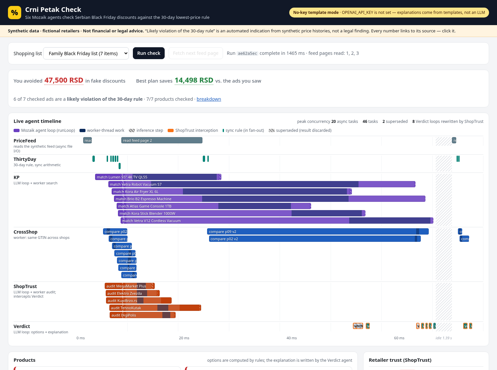

# Crni Petak Check — is this Black Friday discount real?

A multi-agent web app, built on [Mozaik](https://www.npmjs.com/package/@mozaik-ai/core) (`@mozaik-ai/core` **6.0.0**), that checks Serbian Black Friday discounts for fakes and tells a shopper what to do instead.

> **Synthetic data · fictional retailers · not financial or legal advice.** “Likely violation of the 30-day rule” is an automated indication computed from synthetic price histories, not a legal finding.



<sub>Full page: [docs/screenshot-full.png](docs/screenshot-full.png). Taken in the no-key template mode, after pressing “Fetch next feed page”.</sub>

JigJoy Black Friday AI Hackathon — **Finance track**.

---

## What it does

You pick a shopping list (the Black Friday ads you saw). Six agents work on it concurrently and, for every product, produce:

- **A 30-day-rule check of the ad**: the advertised “before” price against the retailer’s own lowest price in the previous 30 days, the real discount, and the part of the advertised saving that is fake.
- **2–3 actionable options**, not a label: **Buy now at X** (cheapest non-flagged retailer), **Buy on KP (sealed)** (matched second-hand listing), **Wait ~N days** (only when the history shows a recurring promo dip; labelled as a heuristic). Each option has its saving in RSD, a confidence level (how many independent signals back it) and a risk level.
- **A plain-language explanation** written by the Verdict agent (LLM, or template text in no-key mode).
- **A headline for the whole list**: “You avoided **X RSD** in fake discounts · Best plan saves **Y RSD** vs. the ads you saw”.

Every number on screen is a link: click it to see the formula and the dataset rows (feed offer, price-history window with the 30-day minimum highlighted, KP listing, retailer audit, law article, or the agent task that produced it).

## The problem and the law

Retailers inflate the “before” price shortly before Black Friday so that an ordinary price looks like a big discount. Serbia closed this loophole in 2026:

- **Zakon o trgovini, čl. 37** (as amended, *Sl. glasnik RS* 52/2019 i **35/2026**): *“Prethodna cena je najniža cena po kojoj je trgovac nudio robu tokom perioda od 30 dana pre početka sniženja cena …”* — the “previous price” shown next to a reduced price must be the **lowest price in the 30 days before the reduction**; for goods in the assortment for less than 30 days, the lowest price over **at least 15 days**. Sources: [paragraf.rs — Zakon o trgovini](https://www.paragraf.rs/propisi/zakon_o_trgovini.html), [amending act (parlament.gov.rs, PDF)](https://www.parlament.gov.rs/upload/archive/files/lat/pdf/zakoni/14_saziv/1266-26-lat..pdf).
- The same Official Gazette issue (35/2026) carries the new **Zakon o zaštiti potrošača**, whose čl. 6 requires retailers to publish machine-readable, real-time price lists — the kind of data this tool is designed to consume ([paragraf.rs](https://www.paragraf.rs/propisi/zakon-o-zastiti-potrosaca-2026.html)).

What the app implements: the 30-day rule and the 15-day variant (product `p10` at DigiPolis is a new listing). It does **not** implement the exceptions for perishable goods or the “gradual, uninterrupted reduction” paragraph.

**Not verified by us:** the application date (1 May 2026 for the Zakon o trgovini amendments) comes from a law-firm summary ([vraneseviclaw.com](https://vraneseviclaw.com/nova-pravila-za-trgovce-sta-donose-izmene-zakona-o-trgovini-i-novi-zakon-o-zastiti-potrosaca/)), not from the Gazette itself. Media coverage often attributes the rule to the new consumer-protection law; the text we found places it in the Zakon o trgovini. The UI says this too.

## Architecture

One Node.js process (`server/index.js`) serves the REST API, a Server-Sent Events stream and the static frontend (`public/`, no build step). Inside it, one Mozaik runtime with one shared state and eight participants:

```
 Shopper (human) ──sendMessage("scan")──▶ ┌──────────── Mozaik runtime (shared CheckerState) ────────────┐
                                          │                                                              │
 PriceFeed ── async file reads ──▶ price.observed {productId, version, offers}                           │
     │                                  │            │               │                 │                 │
     │                           ThirtyDay (sync)  CrossShop       KP (runLoop)     ShopTrust (runLoop)  │
     │                           30-day rule       worker thread   LLM + worker     LLM + worker audit   │
     │                                  │            │               │                 │                 │
     │                           signal.thirtyDay signal.crossShop signal.kp       trust.assessed/flagged│
     │                                  └──────┬─────┴───────────────┘                 │                 │
     │                     spec: (thirtyDay OR crossShop OR kp) AND signals complete    │                 │
     │                           for the CURRENT version AND NOT verdict started        │                 │
     │                                         ▼                                        │                 │
     │                               Verdict (runLoop) ── compute_options tool call ◀───┘                 │
     │                                         │      InterceptionHandler owned by ShopTrust:             │
     │                                         │      waits for audits, rewrites the call's input         │
     │                                         ▼                                                          │
     │                               verdict.ready / verdict.superseded                                   │
 Timeline (observer) ◀── every SemanticEvent (loop events, custom events) ──▶ SSE ──▶ browser             │
                                          └──────────────────────────────────────────────────────────────┘
```

### Agents

| Agent | Mozaik participant | Triggered by (SituationSpecification) | Work | Async? | Output |
|---|---|---|---|---|---|
| **PriceFeed** | `createAgent` | `EventIs("message.sent").and(ProducedByRole("human"))`, `EventIs("feed.poll.requested")` | Reads feed pages `data/feed/page-N.json` with async I/O; each product snapshot bumps the product’s **price version** | async file I/O | `price.observed`, `feed.page.read`, `feed.completed` |
| **ThirtyDay** | `createAgent` | `EventIs("price.observed")` | Zakon o trgovini čl. 37: 30-day (or 15-day) minimum, real vs claimed discount, fake part | **sync** (microseconds; runs inside the fan-out, drawn as thin ticks) | `signal.thirtyDay` |
| **KP** | `createAgent` + `runLoop` | `EventIs("price.observed").and(FirstSnapshotOfProduct)` | Agent loop: inference → `search_kp_listings` tool (trigram search over 12,066 synthetic listings in a worker thread) → inference picks the same model, rejects accessories/variants (JSON) | LLM calls + worker thread | `signal.kp` |
| **CrossShop** | `createAgent` | `EventIs("price.observed")` | Same GTIN across all retailers: current offers, each retailer’s own 30-day minimum, recurring promo dips (worker thread) | worker thread | `signal.crossShop` (discarded if the price version moved on) |
| **ShopTrust** | `createAgent` + `runLoop` + **InterceptionHandler** | `EventIs("price.observed").and(HasUnauditedRetailer)` | Agent loop: `audit_retailer` tool (worker thread) → trust score 0–100 + rationale. **Owns the interceptor that rewrites in-flight Verdict loops** | LLM calls + worker thread | `trust.assessed` / `trust.flagged` |
| **Verdict** | `createAgent` + `runLoop` | `EventIs("signal.thirtyDay").or(EventIs("signal.crossShop")).or(EventIs("signal.kp")).and(SignalsCompleteForCurrentVersion).and(VerdictStartedForCurrentVersion.not())` | Agent loop: `compute_options` tool (rules) → explanation. Answers for an outdated version are discarded | LLM calls | `verdict.ready` / `verdict.superseded` |
| Shopper | `createHuman` | — | Starts scans, requests the next feed page | — | `message.sent`, `feed.poll.requested` |
| Timeline | `createHuman` (observer: handlers only) | `AnyEvent` | Binds Mozaik `loopId`s to tasks, records `inference.*`, `function_call.*`, `interception.*`, `model.answer` steps, streams everything to the browser | — | SSE |

### How Mozaik is used (and where)

| Mozaik API | Where | What for |
|---|---|---|
| `defineRuntime<CheckerState>()`, `RuntimeState` subclass | `server/runtime.js` | One shared state: runs, items (per-product price version + signals), trust audits, tasks |
| `initializeRuntime({ state, inferenceRunnerConfig })` | `server/app.js`, `server/llm.js` | Real provider runner (with key) or the `TemplateInferenceRunner` (no key), both implementing Mozaik’s `InferenceRunner` |
| `createAgent` ×6, `createHuman` ×2, `join` | `server/agents/*.js`, `server/app.js` | Participants |
| `sendMessage`, `sendEvent(SemanticEvent.create(...))` | PriceFeed, all agents | Custom semantic events (`price.observed`, `signal.*`, `trust.*`, `verdict.*`) |
| `SituationSpecification` subclasses with `.and()`, `.or()`, `.not()` | `server/runtime.js`, agents | Checks between agents (e.g. Verdict only starts when all three signals match the current price version) |
| `runLoop(agentId, message, inferenceInput, interceptionHandler)` with `FunctionTool`s | KP, ShopTrust, Verdict | Real agent loops: inference → tool call → inference → `model.answer` |
| `InterceptionHandler` (composed) | `server/runtime.js` (`pinToolArgs`, `composeInterceptors`), `server/agents/shop-trust.js` | (1) guardrail pinning tool arguments to the task’s ids; (2) **ShopTrust rewrites Verdict’s `compute_options` input** to exclude flagged retailers |
| Loop events (`message_received.*`, `inference.*`, `function_call.*`, `interception.*`, `model.answer`) | `server/agents/timeline.js` | The live timeline is built from Mozaik’s own loop events |
| `OpenAIChatCompletions` + custom `GenerativeModel` | `server/llm.js` | Any OpenAI-compatible endpoint via `LLM_BASE_URL` |

### ShopTrust rewrites another agent’s reasoning in flight

Every Verdict loop is started with an `InterceptionHandler` that ShopTrust provides. When the Verdict model decides to call `compute_options`, Mozaik publishes `interception.started` and awaits the handler *before* the tool runs. The handler waits for the audits of every retailer that sells the product (if they are still running), then rewrites the call’s arguments — e.g. `{"excludeRetailers": []}` becomes `{"excludeRetailers": ["r5"], "trust": {...}}` — and Mozaik continues with the rewritten transition (`interception.finished`). The product card shows the effect: *“Without ShopTrust: ~~Buy now at KupiBrzo.rs 9,999 RSD~~ → now: Buy now at MegaMarket Plus 10,499 RSD”*, and “see the rewritten tool call” shows the arguments before and after.

### Care with financial data

- **Every number has a source.** Numbers are objects `{v, f, src[]}` (`server/rules.js`); the UI renders each as a link to its formula and sources; `/api/source?ref=…` resolves `offer:`, `hist:`, `kp:`, `audit:`, `rule:`, `task:` references to the dataset rows. The smoke test fails if any non-zero number lacks a source.
- **The LLM never produces numbers.** Prices, savings, confidence and the recommendation are computed by rules. The model only picks KP matches (ids are validated against the tool’s output; unknown ids are dropped) and writes explanations. A **number guard** rejects any explanation containing a number that is not in the tool output and falls back to template text, marked as such on the card.
- **Stale results never overwrite newer ones.** Each product carries a price version; every task records the version it worked on; results for an older version are marked *superseded* and discarded (CrossShop comparisons and Verdict answers), and earlier verdicts are kept in a superseded history.
- Synthetic data only, fictional retailers, “likely violation” wording, law source with the unverified parts marked, “Not financial advice” on every card.

## How agents run concurrently

Mozaik’s fan-out is synchronous and does not await processors, and Node.js runs JavaScript on one thread. So overlap has to come from real asynchronous work, and the app does not fake any (there is no `setTimeout`/sleep in the application code; the only timer is the SSE keep-alive ping):

1. **Agent loops** (`runLoop`) are fire-and-forget. KP, ShopTrust and Verdict loops for different products and retailers are all in flight at once; each awaits its own inference and tool calls.
2. **With an API key**, each loop makes 2+ LLM calls (network I/O, typically 0.5–3 s). All KP loops, all ShopTrust loops and the CrossShop jobs overlap for seconds; Verdict loops start per product as soon as that product’s signals are complete, while other products are still being matched.
3. **Worker threads** (`server/worker-pool.js`, `server/compute-worker.js`): the KP listing search, CrossShop’s history scans and ShopTrust’s audits run on a pool of 2–4 OS threads, i.e. genuinely in parallel, in both modes. Each worker job’s real start/end is drawn as a dark segment inside its bar.
4. **ThirtyDay is synchronous on purpose** — it is a few comparisons; pretending otherwise would be dishonest. It shows up as thin ticks.

**Honest note on the no-key mode.** Without a key, the `TemplateInferenceRunner` answers instantly (no network), so a whole scan takes ~50–100 ms. The overlap you see in that mode is real but comes only from worker threads and async file I/O, not from model calls; Verdict loops are short, and ShopTrust’s audits usually finish before any Verdict reaches its tool call, so the interception rewrites the input without having to wait (`waited 0 ms`). With a real LLM the same code paths stretch to seconds and the interception can pause a Verdict loop until ShopTrust is done. Whether a late price change lands while a CrossShop job or a Verdict loop is still in flight depends on timing; when it does, that result is marked superseded. The **Fetch next feed page** button always re-checks the affected products and marks the earlier verdicts superseded. `npm run test:llm-path` shows in-flight Verdict answers being discarded, using a mock OpenAI-compatible server with network-like latency.

## Run it locally

Requirements: **Node.js 20+** (tested on Node 24 on Linux and Node 26 on Windows).

```bash
npm install
npm start
# open http://localhost:3000  → pick a list → "Run check"
```

No API key is needed: without one the app starts in **no-key template mode** (yellow badge in the header). Explanations and KP picks then come from deterministic templates/rules, labelled “template” in the UI.

### With a real LLM

Copy `.env.example` to `.env` (or set environment variables) and set **one** of:

| Provider | Variables |
|---|---|
| OpenAI (default) | `OPENAI_API_KEY=sk-…` (model defaults to `gpt-5.4-mini`; change with `LLM_MODEL`, e.g. `gpt-5.4-nano`, `gpt-5.5`) |
| Anthropic / Gemini (Mozaik built-ins) | `LLM_MODEL=claude-haiku-4-5` + `ANTHROPIC_API_KEY`, or `LLM_MODEL=gemini-3.5-flash` + `GEMINI_API_KEY` |
| Any OpenAI-compatible endpoint | `LLM_BASE_URL=https://…/v1`, `LLM_API_KEY=…`, `LLM_MODEL=<model name>` (OpenRouter, DeepSeek, Ollama, vLLM, …) |

Other variables: `PORT` (default 3000), `HOST`, `LLM_REASONING_EFFORT` (default `low`, only sent to models that support it), `LLM_MODE=template` (force no-key mode). `MOZAIK_API_KEY` is read by Mozaik’s own cloud SDK and enables Mozaik Cloud telemetry; leave it unset to keep everything local. If a provider call fails, the loop continues with the template answer and the card says so.

### Tests

```bash
npm test               # no-key mode end to end: overlap, interception, superseded results, sourced numbers
npm run test:llm-path  # the with-key code path against a local mock OpenAI-compatible server
npm run data           # regenerate the synthetic dataset (deterministic seed; output is committed)
```

## Deploy

It is one long-running Node process with in-memory state and SSE, so use a server host, not serverless functions.

- **Render**: “New Web Service” from this repo (or use `render.yaml`, also untested): build `npm ci`, start `npm start`, health check `/api/health`, set `OPENAI_API_KEY` if you want LLM mode.
- **Railway / Fly.io / any Docker host**: the included `Dockerfile` (`node:24-alpine`, `npm ci --omit=dev`, `node server/index.js`; not built or deployed during the hackathon, so treat it as a starting point). The app listens on `$PORT`.
- **VPS + Caddy**: `npm ci && PORT=3000 npm start` under systemd or pm2, and Caddy in front for HTTPS — see `docs/Caddyfile.example` (`flush_interval -1` keeps SSE streaming).

## Project layout

```
server/
  index.js            HTTP server: REST API, SSE, static files, .env loader
  app.js              runtime initialisation, participants, runs, headline, source resolver
  runtime.js          defineRuntime, CheckerState, situation specifications, interception helpers
  llm.js              provider selection, TemplateInferenceRunner, ResilientInferenceRunner
  templates.js        template answers (no-key mode and fallbacks)
  rules.js            30-day rule, cross-shop, trust audit, options, number guard, law reference
  worker-pool.js      worker_threads pool
  compute-worker.js   KP search, cross-shop scan, retailer audit (runs off the main thread)
  agents/             price-feed, thirty-day, kp, cross-shop, shop-trust, verdict, timeline
public/               index.html, app.js, styles.css (no build step)
data/                 synthetic dataset (generated by scripts/generate-data.js)
scripts/              data generator, end-to-end tests
```

## Synthetic data

`scripts/generate-data.js` (fixed seed) creates 5 fictional retailers, 14 fictional products, 60 days of daily prices per retailer (2,240 rows), three Black Friday feed pages (page 2 and 3 are late price changes) and 12,066 KupujemProdajem-style listings (matching items, other variants, accessories and noise). Retailer behaviours are scripted so the checks have something to find: honest discounts, “before” prices inflated two weeks before Black Friday, “before” prices ignoring an in-window promo, stale “before” prices from more than 30 days ago, a product listed for less than 30 days (15-day rule) and retailers with recurring promo dips and no Black Friday discount. Any resemblance to real retailers or prices is unintended.

## License

MIT — see [LICENSE](LICENSE).
